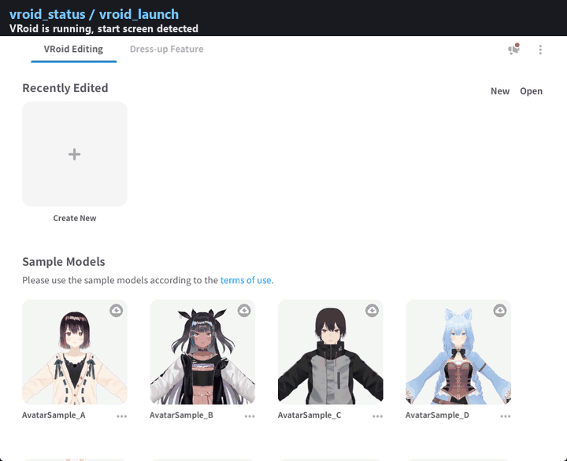
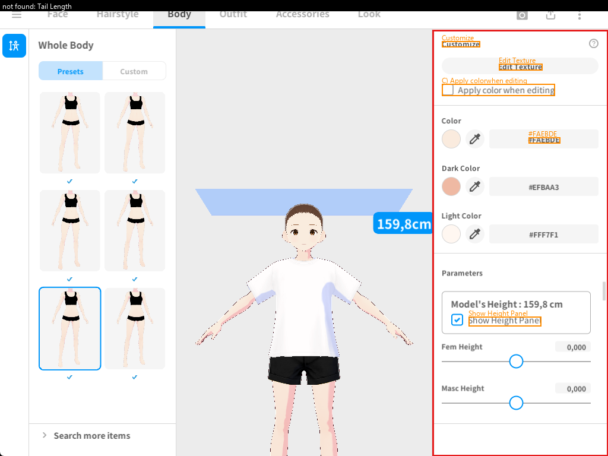

# vroid-mcp

[](https://github.com/Topogamer0/vroid-mcp/actions/workflows/tests.yml)

An [MCP](https://modelcontextprotocol.io) server that lets Claude (Claude Code, Claude Desktop or any MCP client) drive **VRoid Studio on Windows**: open tabs, set body/face parameters, change colours, export a VRM with metadata, and check the exported file.

VRoid Studio has no API, CLI or plugin system, so this server works the way a person does. It **looks at the window** (screen capture + Windows OCR), **uses the mouse and keyboard** (SendInput), and **checks every action** (reads the value back, checks the exported file).



> **Tested with VRoid Studio 2.14.0** (standalone installer, Windows 11, English UI, UI scaling 100 %, Windows display scale 100 %, 1024×768 and 1280×800 windows). Other versions or layouts may need [calibration](#calibration).

## Why it is more reliable than plain "look and click"

| | |
|---|---|
| **Verified actions** | `vroid_set_slider` types into the numeric field, then OCRs the field and compares it with the requested value. It also returns VRoid's own log entry (`SetBoneTransformParameterCommand … Level2Head_HeadScale…`). Tabs are checked by their blue underline. Exports are checked by parsing the written `.vrm`. |
| **Locale-safe numbers** | VRoid parses typed numbers with the Windows locale: on an Italian or German system, typing `0.5` sets **5.0** without any error. The server types the right decimal separator. |
| **No wrong matches** | Labels are matched as whole rows ("Size" never matches "Head Size"). A label found in two places is reported as ambiguous instead of being guessed. |
| **Fast** | Windows' built-in OCR finds a label in ~40 ms. Known widgets are cached and re-validated in ~0.3 ms. Fixed sleeps are replaced by "wait until the UI stops changing". |
| **Clear errors** | When something is missing, the tool returns an annotated screenshot (search area in red, closest texts in orange), plus what it was looking for and a hint. |
| **Native dialogs via UI Automation** | The Windows save dialog is filled through UIA automation IDs: no OCR, no mouse, and it works in any Windows language. |

<details><summary>Example error report</summary>

```
ERROR: could not find 'Tail Length' on screen
Looking for: text 'Tail Length'
Search region (client px, l,t,r,b): (728, 50, 1024, 768)
Closest texts on screen: 'Apply color when editing' (0.38); 'Customize' (0.32); ...
Hint: Check the screenshot: the panel may need scrolling, another tab may be open, ...
```



`vroid_set_slider` goes further: it scrolls the whole panel and lists **every** parameter label of the current tab.
</details>

## Limitations (please read)

- **It is fragile by nature.** It depends on VRoid's layout, labels and colours. A VRoid update can break it until the [profile](src/vroid_mcp/profiles/vroid-2.14.0-en/profile.yaml) is updated or re-[calibrated](#calibration).
- **English UI only** (Settings › Language › English in VRoid). `vroid_status` warns if VRoid's language or UI scaling differs.
- **It briefly takes the foreground.** VRoid draws a blank white window while unfocused and ignores background (PostMessage) clicks. Each tool call therefore focuses VRoid, acts, and then restores your mouse position and the previously focused window. Don't type while a tool is running.
- **Windows only**, one VRoid instance, one action at a time.
- **Not every feature has a high-level tool.** The hair editor, texture painting and the Dress-up feature can be reached with the low-level tools (`vroid_screenshot`, `vroid_click_text`, `vroid_click`, …), but nothing verifies those steps for you.
- The Steam version is detected and launched (`steam://rungameid/1486350`) but has **not been tested**.
- Screenshots go to the MCP client (the model) and are not stored on disk.

## Requirements

- Windows 10 (1903+) or 11.
- [VRoid Studio](https://vroid.com/en/studio) 2.14.0 (standalone; Steam probably works too).
- [uv](https://docs.astral.sh/uv/) (it installs Python ≥ 3.11 for you).
- A **Windows OCR language**. Any Latin-script language works (en-US, it-IT, fr-FR, …), and most Windows installs already have the one matching their display language. Check with `vroid_status` or the [smoke test](#development). To add English, run in an admin PowerShell:
  ```powershell
  Add-WindowsCapability -Online -Name "Language.OCR~~~en-US~0.0.1.0"
  ```

## Install

```bash
git clone https://github.com/Topogamer0/vroid-mcp.git
cd vroid-mcp
uv sync
```

## Register with Claude Code

Use the absolute path of the folder you cloned:

```bash
claude mcp add vroid -- uv run --directory "C:\path\to\vroid-mcp" vroid-mcp
```

If VRoid is installed somewhere unusual, add environment variables:

```bash
claude mcp add vroid -e VROID_EXE="D:\Apps\VRoidStudio\VRoidStudio.exe" -- uv run --directory "C:\path\to\vroid-mcp" vroid-mcp
```

Or run straight from GitHub without cloning:

```bash
claude mcp add vroid -- uvx --from git+https://github.com/Topogamer0/vroid-mcp vroid-mcp
```

Then, in Claude Code, `/mcp` should list `vroid` with 15 tools.

<details><summary>Claude Desktop / other clients (JSON config)</summary>

```json
{
  "mcpServers": {
    "vroid": {
      "command": "uv",
      "args": ["run", "--directory", "C:\\path\\to\\vroid-mcp", "vroid-mcp"]
    }
  }
}
```
</details>

## Configuration

| Variable | Default | Meaning |
|---|---|---|
| `VROID_EXE` | auto | Full path to `VRoidStudio.exe`. If not set, the server looks in `%LOCALAPPDATA%\Programs\VRoidStudio\<version>\`, then the uninstall registry, then Steam libraries. |
| `VROID_MCP_OUT` | `Documents\vroid-mcp` | Where relative export paths go. |
| `VROID_MCP_MAX_IMAGE_PX` | `1280` | Longest edge of the screenshots sent to the model (JPEG). Lower it to save tokens. |
| `VROID_MCP_CAPTURE` | `auto` | `wgc` (Windows Graphics Capture), `printwindow` or `screen`. |
| `VROID_MCP_PROFILE` | `vroid-2.14.0-en` | UI profile to use. |

## Tools

| Tool | What it does |
|---|---|
| `vroid_status` | Install path, running state, version, window size, DPI, **unsaved changes** (`*` in the title), VRoid language/scale, decimal separator, warnings. Read-only. |
| `vroid_launch` | Start VRoid if needed and wait for the start screen. Optional `width`/`height` for the client area. `restart` needs `confirm=true`. |
| `vroid_close` | Close VRoid. **Refuses unless `confirm=true`** and reports whether unsaved changes were lost. |
| `vroid_screenshot` | Client area only, downscaled JPEG (~40 KB), plus the detected screen (`start`, `editor`, `export`, `vrm_settings`, …). |
| `vroid_find_text` | OCR search. Returns boxes and centres in client and image pixels. |
| `vroid_click` / `vroid_click_text` | Click a point (`space="client"` or `"image"`), or click a label found by OCR. |
| `vroid_type` / `vroid_key` / `vroid_scroll` | Raw keyboard and wheel input. |
| `vroid_open_tab` | Face, Hairstyle, Body, Outfit, Accessories or Look, **verified**. |
| `vroid_set_slider` | Set a parameter by **typing its value** (never dragging), with scrolling, read-back and log evidence. |
| `vroid_set_color` | Set a `#RRGGBB` colour field and read it back. |
| `vroid_export_vrm` | Full export: VRM 1.0 or 0.0, name, version, creators, Windows save dialog, wait for the file, back to the editor, parse the result. **Refuses to overwrite** without `overwrite=true` (the old file is kept as `.bak.vrm`). |
| `vroid_inspect_vrm` | Read any `.vrm` without VRoid: VRM version, metadata and permissions, humanoid bones (and missing required ones), expressions, blendshapes, texture sizes. |

## Examples

Things to ask Claude once the server is registered:

- "Open VRoid, create a new feminine model, make the head 10 % smaller and the eyes a bit bigger, then export it as `small_head.vrm` with name *Test* and creator *me*."
- "On the Body tab set Fem Height to 0.3 and Leg Length to 0.2, then show me a screenshot."
- "Set the skin Color to #F5DCCB."
- "Export the current model as VRM 0.0 to `D:\avatars\alice.vrm`, then check that it has all required humanoid bones."
- "Inspect `C:\Users\me\Downloads\model.vrm`: which expressions and texture sizes does it have?"

A typical tool result:

```json
{
  "label": "Head Size", "requested": -0.2, "typed": "-0,200", "before": 0.0, "after": -0.2,
  "verification": {"verified": true, "detail": "field reads '-0,200'"},
  "log": [{"command": "SetBoneTransformParameterCommand",
           "params": {"Level2Head_HeadScaleShrink": 0.2, "Level2Head_HeadScaleMag": 0.0}}]
}
```

## Safety

- No destructive action without an explicit flag: `overwrite=true` (exports), `confirm=true` (restart, close). The tool descriptions tell the model to ask you first.
- The server never saves or closes your project on its own, and never clicks "don't save".
- It injects real mouse and keyboard input into your session, so use it attended, on your own machine.

## Calibration

If a VRoid update moves icons, re-record them instead of waiting for a release:

```bash
uv run vroid-calibrate list                  # icons/anchors in the active profile
uv run vroid-calibrate check                 # which ones resolve on the current screen
uv run vroid-calibrate record export_share   # hover the icon in VRoid, press Enter here
```

Recorded profiles go to `%APPDATA%\vroid-mcp\profiles\` and override the bundled one. Text labels need no calibration, because they are found by OCR. PRs with profiles for new VRoid versions are welcome.

## Development

```bash
uv sync
uv run pytest                                # 90+ tests, no VRoid needed (OCR tests need Windows OCR)
uv run python scripts/smoke_test.py          # start the server over stdio, list tools, status
uv run python scripts/probe.py               # environment probe (UIA, capture backends, OCR)
uv run python scripts/e2e_manual.py          # real VRoid: new model > Head Size > export > inspect
```

The design notes and the measurements behind every choice are in [docs/DESIGN.md](docs/DESIGN.md).

```
src/vroid_mcp/
  server.py          MCP tools (stdio)
  session.py         focus / capture / input around each tool call
  flows/             editor (tabs, sliders, colours), export, lifecycle
  vision/            Windows OCR, label matching, locator (cache > OCR > template), imaging
  win/               DPI + coordinates, window, capture (WGC/PrintWindow), SendInput, file dialogs
  formats/vrm.py     VRM 0.x/1.0 reader
  profiles/          measured UI layout per VRoid version
```

## Credits

- Inspired by [**mcp-vroid**](https://github.com/nhodges/mcp-vroid) by **nhodges**, the Linux/Wayland original. The tool names and the overall approach come from there. The Windows side, the verification layer and the matching were rewritten.
- VRoid and VRoid Studio are trademarks of pixiv Inc. This project is not affiliated with or endorsed by pixiv. The screenshots of VRoid Studio in `docs/` and `tests/fixtures/` show its user interface and are used only to document and test this tool.

## License

[MIT](LICENSE)
